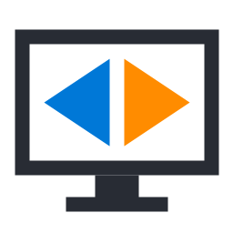

<p align="center"></p>

<h1 align="center">Monitor Flipper</h1>

<p align="center"><b>Mirror any monitor or window to another screen, flipped. Built for teleprompters.</b><br>
Free, open source, one small .exe, nothing to install.</p>

---

## Why

Teleprompter glass reflects the screen underneath it, so the picture has to be **mirrored left-to-right** before it reaches the talent's eyes. Most prompter software handles this only inside its own app, and Windows itself can rotate a display but not mirror it.

Monitor Flipper flips **anything** on your PC: your script app, a browser, slides, notes, a video call, or the whole desktop. You run the prompter screen as a normal second monitor and keep working on your main one.

It is also useful for:

- **Beam-splitter and "Pepper's ghost" rigs**, heads-up displays, and reflected stage monitors
- **Ceiling- or rear-mounted projectors** that need a vertical or horizontal flip
- **Presentations**: plain mirroring (no flip) of your main screen onto one or more extra monitors

## Features

- **Flip horizontally, vertically, or both.** Change it while it's running.
- **Mirror a whole monitor or a single program window.** Window mirroring keeps working when other windows cover it.
- **Show it on one or more monitors at once**, or in a resizable window.
- **GPU-powered.** Smooth at your monitor's full refresh rate and uses about 2% of one CPU core. When nothing on screen changes, it does almost nothing.
- **Mouse pointer included**, flipped along with the picture, including the inverting text cursor.
- **Different resolutions are fine.** Keeps proportions with black bars, or stretches to fill.
- **Same-monitor mode.** Flip a screen in place. Clicks pass straight through to the apps underneath.
- **Portrait (rotated) monitors** are handled automatically.
- **Tray icon, global hotkey (Ctrl+Alt+F), and optional start with Windows**, so a prompter rig can come up flipped with no clicks.
- **Remembers your settings.**

## Download

Get `MonitorFlipper.exe` from the [**Releases**](../../releases) page and run it. You don't need an installer, an admin account, or any extra downloads.

> Windows may show a "Windows protected your PC" notice the first time, because the exe isn't code-signed yet (signing is on the way; see [Code signing policy](#code-signing-policy)). Click **More info → Run anyway**. You can also build it yourself from the source (see below).

Every release exe is built from this source code by GitHub Actions. You can see the build log for each one.

**Requirements:** Windows 10 (version 2004 or later) or Windows 11, and any graphics card that supports DirectX 11 (practically all of them).

## How to use

1. Open **Monitor Flipper**.
2. **Mirror from:** pick the monitor or program window you want to show.
3. **Show on:** tick the monitor(s) where the flipped picture should appear. For a teleprompter, that's the monitor under the glass.
4. **Flip:** tick **Horizontally** for a standard teleprompter. Add **Vertically** if your rig needs it.
5. Press **Start** or **Ctrl+Alt+F**. Press **Ctrl+Alt+F** again to stop.

Minimize the window to send it to the tray. Right-click the tray icon to start, stop, or change the flips.

### Teleprompter tips

- Put your script app on your main screen and choose it under **Mirror from**, then pick the prompter monitor under **Show on**. You edit and scroll normally, and the talent sees it mirrored.
- Most prompter glass needs only **Horizontally**. Some under-monitor rigs also need **Vertically**.
- For a dedicated prompter PC, tick **Start Monitor Flipper with Windows** and **Start mirroring as soon as it opens**.

## Good to know

- The flipped output **doesn't appear in screenshots, screen recordings, or screen shares**. This is deliberate: it keeps the mirror from copying itself. The original screen still shares normally.
- Window mirroring uses Windows' built-in window capture. Minimized windows can't be captured, so leave the source window open (it can sit behind other windows).
- Protected video (some streaming services) may show as black, because Windows blocks capturing it.

## Build from source

You don't need Visual Studio or any SDK. Windows already includes the C# compiler this uses.

```
git clone https://github.com/grungenut/monitor-flipper.git
cd monitor-flipper
Project\build.cmd
```

The exe lands in `Project\bin\MonitorFlipper.exe`.

To check the GPU flip accuracy on your machine, run `Project\bin\MonitorFlipper.exe --selftest result.txt`. It flips and rotates your screen image on the GPU and compares every pixel, without showing or saving any images.

### How it works

| Piece | What it does |
|---|---|
| `Project/src/Engine.cs` | Captures frames with Windows Desktop Duplication (monitors) or Windows Graphics Capture (windows), then draws them with Direct3D 11. Flipping and rotation happen on the GPU and cost nothing extra. |
| `Project/src/WindowCapture.cs` | Single-window capture. |
| `Project/src/Gpu.cs` | Minimal Direct3D / DXGI bindings (raw COM), so the project has no dependencies. |
| `Project/src/MonitorFlipper.cs` | Settings window, tray icon, output windows. |

## Contributing

Issues and pull requests are welcome. Please keep it focused: Monitor Flipper does **mirroring and flipping**, and does it well.

## Code signing policy

Free code signing provided by [SignPath.io](https://about.signpath.io), certificate by [SignPath Foundation](https://signpath.org) (application in progress; releases are unsigned until it is approved).

- **Committers and reviewers:** [grungenut](https://github.com/grungenut)
- **Approvers:** [grungenut](https://github.com/grungenut)

Only exes built by this repository's GitHub Actions from its own source are signed, and every signing is approved by hand.

**Privacy:** This program will not transfer any information to other networked systems unless specifically requested by the user or the person installing or operating it. It has no network code at all. Settings are stored only on your PC, in `%APPDATA%\MonitorFlipper\settings.txt`.

## License

[MIT](LICENSE). Copyright (c) 2026 Monitor Flipper contributors.
